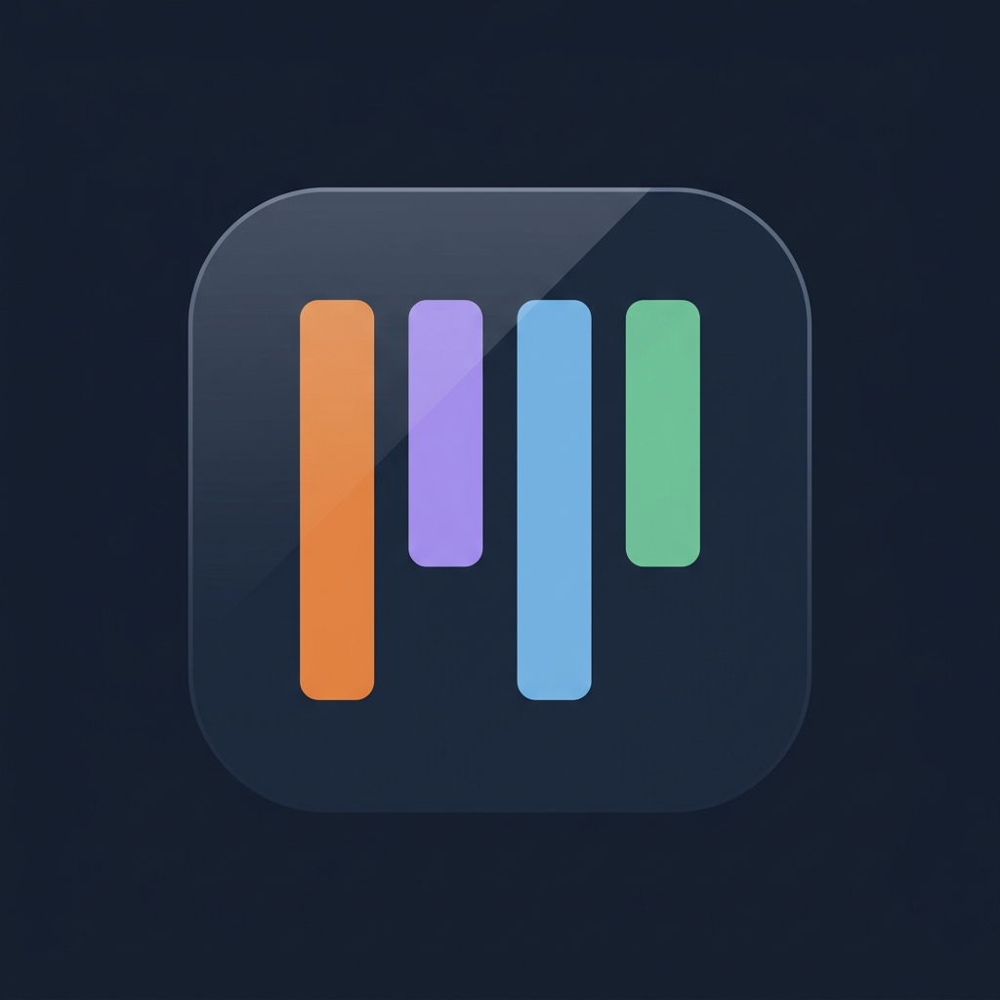
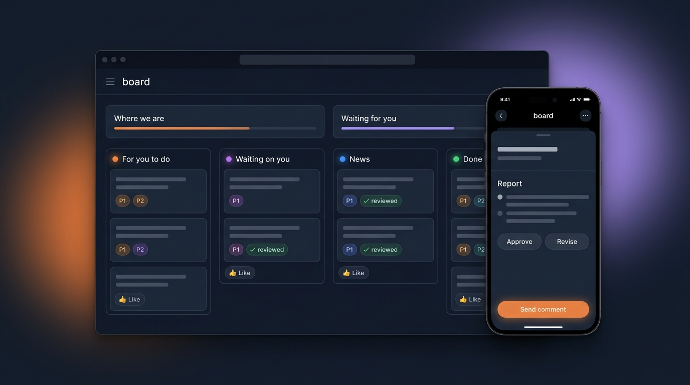
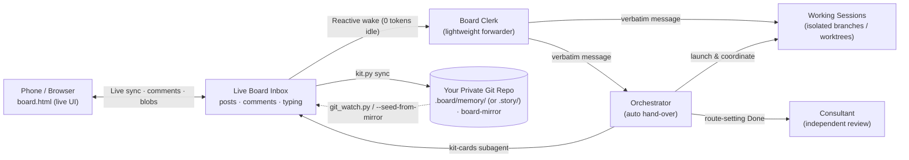

<p align="center">
  
</p>

<h1 align="center">board</h1>

<p align="center">
  <strong>One workspace for everything you and your AI work on — from a single chat to a full team of agents.</strong><br />
  Works on your computer, your phone, or inside <code>claude.ai</code> — for code, research, operations, or everyday office work.<br />
  Zero dependencies. Private by default. Zero lost context.
</p>

<p align="center">
  
  
  
  
  
</p>

<p align="center">
  <a href="#who-its-for">Who It's For</a> ·
  <a href="#what-you-get">What You Get</a> ·
  <a href="#choose-your-setup">What Works Where</a> ·
  <a href="#quick-start">Quick Start</a> ·
  <a href="#install">Install</a> ·
  <a href="#security--privacy">Security</a>
</p>

<p align="center">
  
</p>

---

## Who It's For

`board` is built for **anyone doing multi-day work with AI** — whether it is your first week using AI or you run parallel coding agents every day:

- **Just getting started with AI?** Stop losing decisions across 20 dead chat tabs. Every new session starts already knowing where your project stands, what you decided, and what comes next.
- **Managing operations, research, or office workflows?** Approve a draft or answer a question from your phone in two seconds; open linked **SharePoint files, Gmail threads, Google Drive docs, Notion pages, or Linear issues** right inside a reader window using your own account.
- **Building software or orchestrating multiple agents?** Inspect live git diffs, screenshots, and deliverables in floating windows; let a 0-token clerk route your phone comments straight to the exact running session; hand over cleanly before context limits hit.

---

## Why `board`?

Chat windows break down as soon as a real project lasts more than a day — even with a single session:

- **Decisions vanish in dead chats** → `board` keeps durable project memory right in your private repository.
- **Every new session asks *"where are we?"*** → every session automatically starts with each workstream's exact `Next:` step, open questions, and standing rules already injected.
- **Passive trackers don't talk back** → commenting on a card from your phone wakes the exact agent that wrote it, with live typing dots and one-tap approvals.
- **Docs, links, diffs, and outputs are scattered** → read repo docs, compare deliverables with live diffs, and open authenticated cloud links in one OS-style multi-window workspace.
- **Unchecked agents lose work or burn tokens** → built-in safety hooks block destructive commands and secret leaks, while compact lookups cut context usage by up to 12x.

---

## What You Get

### 1. A Live Two-Way Control Room
- **Four views, four lanes:** switch seamlessly between **Lanes** (`Action`, `Decisions`, `Updates`, `Done`), **Trains**, **Feed**, and **Focus** — all deep-linkable (`#/post/<id>`, `#/focus`).
- **Phone-first control & pocket push alerts:** tap to approve, pick a one-tap option, snooze a card for 24 h, bulk-approve, attach screenshots up to 20 MB, watch live typing dots, and get optional **pocket push notifications** (`ntfy.sh` / webhook via `--notify-url` or the in-board Share panel) that deep-link straight to the card.
- **OS-style floating windows:** pop out posts, Ask the Orchestrator, Repo Docs, deliverables, and external links into movable, 8-edge-resizable, edge-snappable windows with strict scroll containment.

### 2. Everything Readable in One Place
- **Pointer-aware Repo Docs & Memory Reader:** hover the left edge for the file switcher and the right edge for the document outline; pin key docs and comment on sections.
- **Deliverables Drop-Box:** agents and collaborators attach scripts, docs, or HTML previews directly to any post — with automatic live diffs against the repo and zero GitHub write access required.
- **Pluggable MCP Link Reader:** open **SharePoint / OneDrive files, Gmail threads, Google Drive docs, Outlook messages, Notion pages, and Linear issues** inside a floating reader window using *each viewer's own connector* (auto-detected during Step 0 setup).

### 3. Memory That Compounds & Trains That Stay Current
- **Committed memory (`.board/memory/`, or existing `.story/`):** workstream state (`Next:` + `## Steps`), open questions (`awaits.md`), issues, lessons, and standing preferences — automatically injected at session start.
- **At-a-glance progress ("Where we are" & "Trains"):** tracks multi-step work automatically from `## Steps` or from linked train posts (`train` + `parent`), rebuilt live on the local server or nudged via `kit_cards_reminder.py` in Claude Code Web.
- **Automatic handovers & independent reviews:** orchestrators and clerks hand over before context ceilings, and a fresh **consultant** verifies route-setting milestones before you commit to the next phase.

### 4. Share Safely with People & Other AIs
- **Board-scoped collaborators:** invite teammates (`viewer`, `member`, or `owner`) scoped to a specific board in multi-project portfolios, each with their own private Ask-the-Orchestrator channel. The local board enforces it on every route (`kit/board/access.py`, deny by default): a link gives its own rights, a member writes as themself (the board signs it) and changes their own posts and the state of posts that are `for` them, only the owner (or the person a question is for) answers, only a proof completes a step, and every change is logged with who made it. Agents are told when words are a collaborator's, not the owner's. **An Artifact has none of this:** anyone claude.ai lets edit it can write anything there, so share it to edit only with people you would give the owner's rights; others get "can view".
- **1-link AI bootstrap & Link for AI:** hand any external AI a 24 h expiring share link (`/_share/<token>`), a collaborator bootstrap brief (`/_invite/<token>.md`), or a self-contained post brief on Artifacts.

---

## Choose Your Setup

| Capability | Local (`agy` / CLI) | Cloud (`claude.ai` Artifact) | Sandbox / Generic (`arena` / Codex / Cursor) |
|---|---|---|---|
| **Requires a terminal?** | One-word launcher (`<project>`) | **No** (runs in `claude.ai`) | Yes (inside sandbox / CLI) |
| **Live UI, 4 views & OS windows** | Yes (desktop + phone via Tailscale) | Yes (browser + phone in `claude.ai`) | Yes (preview iframe / localhost) |
| **Phone comment → right agent** | Clerk + SSE (0 tokens idle) + `ntfy.sh` push | Clerk + ArtifactComments wake + `ntfy.sh` push | `comments wait` live listener |
| **Where we are & Trains** | Auto-rebuilt by server | Rebuilt by `kit-cards` (+ reminder hook) | `kit-cards` |
| **Repo Docs & live diffs** | Live from disk | Mirrored via `kit_artifact_sync.py` (256 KiB/doc) | Live from disk |
| **MCP Link Reader (SharePoint, Gmail, Drive, ...)** | Local MCP / browser | **Yes** — viewer's own connector (Step 0 auto-detected) | Local MCP / browser |
| **Deliverables drop-box (w/ diff)** | Yes (`/_api/posts/<id>/artifacts`) | Yes (`kit_artifacts` collection) | Yes |
| **Collaborators & Link for AI** | Board-scoped invites + 24 h `/_share` | Artifact Share menu + self-contained AI brief | Token links + invites |
| **Offline outbox & multi-board portfolio** | Yes (SQLite + Git mirror) | No (cloud Artifact DB) | Partial (Git handoff) |

---

## How `board` Compares

| | **`board`** | Local Kanban Trackers | CLI Issue Graphs | Cloud PM Tools (Linear / Notion) |
|---|---|---|---|---|
| **Built for non-developers too?** | **Yes** (code, ops, office, cloud Artifact) | Dev-focused | CLI-only | Yes, but manual |
| **Active phone-to-agent loop** | **Yes** (0-token clerk + live typing dots) | Passive tracker | No UI | Third-party bots |
| **Dependencies & hosting** | **Zero** (Python 3 stdlib + 1 HTML file) | Go / Node binary or paid cloud | Go + Dolt DB | Their cloud (per-seat) |
| **Docs, diffs & cloud link reader** | **Built-in** (OS windows + MCP Reader) | Basic card editor | None | Separate tools |
| **Built-in agent safety & handovers** | **Yes** (guardrails, handovers, consultant) | None | Schema guard | None |

---

## Measured in Production

Real numbers measured on [anlonlt/harmonize](https://github.com/anlonlt/harmonize) ([full methodology](docs/KIT-GOALS.md)):

| Metric | Measured Result |
|---|---|
| **Production volume** | **173 posts**, **1,279 comments**, **47 orchestrator handovers** across 22 workstreams |
| **Median wait for an agent reply** | **0.8 min** across 398 owner comments (0 over 15 min in recent handover windows) |
| **Context saved per read** | **12x smaller** post reads (35.9k → 2.9k chars); open comments **~120k tokens → 290 chars** |
| **Startup memory footprint** | **22 workstreams + 31 waiting items** injected in **6.6k chars** (instead of 1.3 MB of docs) |

---

## Quick Start

**Starting fresh (works in `agy`, Claude Code Web, Codex, Cursor, or LMArena):**
Open an AI session in your project and paste this single link — the agent auto-detects your environment, runs Step 0 to see what your project needs, and installs only the layers that pay for themselves (or pass `--quick` to `install.py` for a <60s trial setup):

```text
https://github.com/anlonlt/board/blob/agy-local/README.md
```

**Already installed:**
- **Local (`agy`):** open any terminal and type your project's one-word command (e.g. `harmonize`; add `--hybrid` to bridge with a cloud Artifact).
- **Claude Code Web:** open your project's `claude.ai` Artifact board link.
- **Starting from scratch (any AI client, even with 0 prior chats):** paste [step0/survey-universal.md](step0/survey-universal.md) into Claude, Gemini, ChatGPT, `agy`, or Cursor — it inspects your connected MCPs (read-only, with consent) to map your active workstreams, detects which MCP Link Readers to enable, and sets up your private Git repo as permanent board memory.

---

## Security & Privacy

- **Private by default:** your live board runs in local SQLite (or your private `claude.ai` Artifact) and backs up only to your own private Git repository. Zero third-party telemetry or hosting.
- **Treat invite links as credentials:** `/_invite/<token>.md` and `/?token=` grant board access. Never paste them into public GitHub issues or chats. In Claude Code Web, store the token once as an environment secret (`request_credential`, header `X-Kit-Token`) and use the `proxy` placeholder.
- **Artifact mirror visibility:** `kit_artifact_sync.py docs` copies your project's docs and memory into the Artifact DB, so anyone you share that Artifact with can read them.
- **Per-viewer MCP permissions:** the MCP Link Reader always calls connectors using **each viewer's own account** — viewers only see SharePoint files, Gmail threads, or Drive docs they already have access to.
- **Privacy-safe pocket pushes:** `ntfy.sh` notifications omit post titles and body text by default (`"A post needs you"` + deep link); opt in with `kit.notify_detail: true` only on private topics. The local board and the Artifact notify the same topic by one rule (`.kit/notify.py`): a post that enters To do or Waiting on you, once; a tap opens the board it was written on, a button the other one. The topic is as good as a password: the Share panel keeps it in `.kit/board_data/` (git-ignored); for web sessions use `kit.notify_url` in a private repo, the environment variable `KIT_NOTIFY_URL` in a public one (`KIT_FUNNEL_URL` or `kit.funnel_url` adds the local board's button there).

---

## Install

> [!TIP]
> **For the agent reading this page:** auto-detect which environment you are running in and follow the matching collapsible install section below:
> - **On a local computer — Antigravity (`agy`) or the Claude Code CLI (`claude`):** follow **Install (Local: `agy` or Claude Code CLI — default)**. One install serves both CLIs.
> - **Claude Code Web (`claude.ai/code` with Artifacts):** follow **Install (Claude Code Web — `--runtime claude`)**.
> - **LMArena / E2B / sandboxed preview iframe / Codex / Cursor / generic CLI agent:** follow **Install (LMArena / Sandbox / Generic Agent — `--runtime arena`)**.

<details>
<summary><strong>Install (Local: <code>agy</code> or Claude Code CLI — default)</strong></summary>

The default `--runtime local` installs the hooks for **both** CLIs (`.agents/` for agy, `.claude/` for Claude Code) on one local board, and records in `kit.cli` which CLI the one-word command opens: the CLI running the install, else the one installed (agy first). Override with `--cli agy|claude`, or per launch with `<cmd> --agy` / `<cmd> --claude`. Steps 3-5 below name agy's tools; a Claude Code CLI session follows `.kit/claude-cli/orchestrator.md` instead, which maps them:

| agy | Claude Code CLI |
|---|---|
| `run_command` daemon (`IsDaemon`, `WaitMsBeforeAsync`) | `Bash` with `run_in_background: true` (woken when it exits) |
| clerk subagent (`flash_lite`) | clerk **session** `claude --bg -n <slug>-clerk --model haiku` (only relays; the orchestrator never sees comments meant for a part) |
| part subagent, `Workspace: "share"` | part **session** `claude --bg -n <slug>-<part> -w <part>` (its own worktree; the clerk reaches it by name) |
| `send_message` to a conversation ID | `SendMessage` to a session name (`<slug>-orchestrator`, `<slug>-<part>`) |
| `define_subagent` / `invoke_subagent` for `kit-cards`, consultant | `Agent` (`.claude/agents/kit-cards.md`) |
| handover at the context limit | Claude Code compacts; `state/orchestrator.md` + the `SessionStart` hook re-brief it |

All the kit's Claude sessions run in the same permission mode (`kit.claude_permission_mode`, default `auto`): a session in another mode holds cross-session messages for approval. `claude --bg` needs the folder trusted once: run `claude` in the project and accept the prompt (the one-word command does this on its first launch).

**The wizard** (`--tui`) is a terminal screen: it shows only when the person runs it in their own terminal. Run by an agent (no terminal), it installs Step 0's recommendations silently, so an agent instead runs `python3 -I /tmp/board-kit/scripts/twrp_wizard.py . --print-choices`, asks the person each choice with its own question tool (palette, autonomy, runtime, CLI, scope — **trunk push is never assumed**), then runs it with `--headless` and the answers as flags.

The hooks' "end your turn with `·`" reminder is about chat turns: your step reports go in the post.
Steps marked **YOU** need a person; the agent prints each one with its direct link when it gets there. Everything else runs automatically.

**For the installing agent, in the project's session.** Do the steps in order; report each step's outcome in one line.

0. **Step 0 first, always:** run the universal survey (`step0/survey-universal.md` — works across any AI client & connected MCPs; or `step0/survey-code.md` / `step0/survey-chat.md`). Show its report to the owner; their yes or changes decide the parts. `install.py` refuses a first install without `--survey <path>` (or `--no-survey "<why>"` / `--quick`).
1. **Get the kit (pin a reviewed commit or tag):** `install.py` copies executable hooks into your repository, so pin a reviewed commit SHA or release tag rather than blindly tracking a mutable branch:
   ```bash
   git clone https://github.com/anlonlt/board /tmp/board-kit
   git -C /tmp/board-kit checkout <reviewed-commit-sha-or-tag>   # e.g. the latest reviewed commit on main
   ```
2. **Install it** into the project root:
   ```bash
   python3 -I /tmp/board-kit/install.py . \
     --project "<the project's name>" \
     --talk "<language>" \
     --survey survey/<date>/report.md
   ```
   Optional flags: `--cli agy|claude` (which CLI the one-word command opens; default: detected), `--cmd <one-word-command>` (default: project slug, installed to `~/.local/bin/<cmd>`), `--memory-dir <path>` (default: `.story` if present, else `.board/memory`), `--board-port 8765`, `--notify-url https://ntfy.sh/<topic>` (pocket push alerts), `--runtime agy|claude|both`, `--mode local|hybrid`, `--attach <name=path | name=github:owner/repo>` (another repo's board: on the local board and, mirrored with `kit_artifact_sync.py boards`, in the Artifact), and partial flags (`--no-board`, `--no-clerk`, `--no-orchestrator`).
   It never deletes and never replaces a file it did not write (`KEPT` lists what it left alone). Existing hook configs are preserved and merged cleanly.
   Check: `python3 -I .agents/hooks/kit/test_hooks.py` ends `0 failed`.
   **Permissions the repo already gives are kept:** a first install turns trunk push on when the project's `CLAUDE.md` / `AGENTS.md` already grants pushing `main`, and takes `.claude/settings.json`'s `defaultMode` as the sessions' permission mode (it prints the file and line); a rerun or `--update` never turns off one already on in `.kit/config.json`.
   **When nothing grants it, ask the owner once** (a terminal install asks itself; a repo with none stays off): *"Every session ends by merging its work onto `<main branch>` and pushing it, never forced (a conflict stops it). Do you give that standing permission?"* Yes: rerun with `--trunk-push yes`. No: sessions push only their own branch. Either way each session ends with `python3 -I .kit/end_session.py`.
3. **Translate (if non-English), then start the board & phone access** (with a board only):
   - If `--talk` is not English: `python3 -I .kit/strings.py template .kit/strings.json`, fill in translations, rerun step 2 with no options.
   - Start the local board server bound to loopback (`127.0.0.1`, recommended with `tailscale serve`) — or pass `--token` / `KIT_BOARD_TOKEN` if binding a non-loopback address (non-loopback binds refuse to start without a token; `./.kit/up` generates and uses a token automatically). For a background daemon: `run_command` with `CommandLine: "python3 -I .kit/board_server.py --host 127.0.0.1 --port 8765"`, `IsDaemon: true`, `WaitMsBeforeAsync: 1000`. Verify `curl -sf http://127.0.0.1:8765/_api/health`.
   - **Phone access via Tailscale (automatic; skipped in cloud-Artifact-only setups):**
     1. Check `which tailscale`: if missing, install it automatically (`curl -fsSL https://tailscale.com/install.sh | sh` on Linux).
     2. Run `sudo tailscale up` in the background (`WaitMsBeforeAsync: 5000`) and hand the owner the one-time login link (`https://login.tailscale.com/a/...`) plus the phone app links ([Android](https://play.google.com/store/apps/details?id=com.tailscale.ipn) · [iOS](https://apps.apple.com/app/tailscale/id1470499037)).
     3. Once `tailscale up` finishes, run `sudo tailscale serve --bg 8765` AND read `tailscale ip -4`. Give the owner **both** links automatically:
        - HTTPS hostname: `https://<machine>.<tailnet>.ts.net/` (enable MagicDNS + HTTPS Certificates once at https://login.tailscale.com/admin/dns)
        - Direct Tailscale IP fallback: `http://<tailscale-ip>:8765/`
     4. **Android Private DNS / NextDNS note (tell the owner upfront):** if their phone uses NextDNS or another Private DNS, Android + Tailscale DNS can conflict ("no network access"). Two fixes: (a) quick: toggle **Use Tailscale DNS = OFF** in the Tailscale app and use `http://<tailscale-ip>:8765/`; or (b) permanent: add NextDNS in Tailscale Admin → Global nameservers and set Android Private DNS to **Automatic**.
     5. Rerun step 2 with `--board-url <the working phone url>`.
   - Commit `.kit .agents .claude .board .gitignore` (or `.story` if already present) and push.
4. **Post your first two posts** in one `board_cli.py batch` (`.kit/BOARD.md` § Post; `created_at` from `date -u +%Y-%m-%dT%H:%M:%SZ`):
   `_orchestrator` (`{title: "Ask the orchestrator", column: "info", part: "orchestrator", priority: 3, created_at, body: "Write here for anything that is not about one post."}`) and
   `KIT-installed` (`{title: "The board kit is installed", column: "info", part: "KIT", priority: 2, session_id: "<your conversationId>", created_at, body: "<what step 2 wrote and kept>"}`).
5. **Start the orchestrator and the clerk** (only those installed):
   - Launch the clerk via `invoke_subagent(TypeName="self", Role="Board Clerk", Model="flash_lite", Workspace="inherit", Prompt=<text of .kit/clerk.md>)`. It registers `comments watch --on`, listens in the background with `board_cli.py comments wait`, and notifies the orchestrator.
   - Run the orchestrator: its prompt is `python3 -I .kit/kit.py resume --role orchestrator`; it writes its conversation ID into `_orchestrator`, builds "Where we are" via `kit-cards`, and posts its welcome under `_orchestrator` (including the one-word launch command, phone links, and unattended mode).
6. **YOU, the first comment:** open your phone or local board URL, open `KIT-installed`, write `"test"` and tap **Send comment**. The clerk wakes immediately, passes it to this session via `send_message`, marks it "Seen" and replies "Passed to ...". Answer it under the post (`board_cli.py set comments ...`).
7. **The board's copy in git** (`.kit/ORCHESTRATOR.md` § 3):
   `python3 -I .kit/kit.py init`; `T0=$(date -u +%Y-%m-%dT%H:%M:%SZ)`; `python3 -I .kit/board_cli.py list posts --out-dir /tmp/kd`; `python3 -I .kit/board_cli.py list comments --out-dir /tmp/kd`; `python3 -I .kit/kit.py sync /tmp/kd --at "$T0" --full --commit`; `python3 -I .kit/kit.py post KIT-installed`; `python3 -I .kit/kit.py push`.
   *(Omitting `--limit` fetches every post and comment without truncating boards over 1,000 comments; pass `--limit N --all` to paginate explicitly.)*
8. **Report**, then end the setup: `python3 -I /tmp/board-kit/install.py . --setup-done`, commit, push. Update `KIT-installed` (`board_cli.py update`) with each step's outcome.
9. **Tell the person what now**, in their language (`language.talk`): their one-word terminal command (e.g. `harmonize`), their phone & local board URLs, what runners are ready, and how to import existing history.

</details>

<details>
<summary><strong>Install (Claude Code Web — <code>--runtime claude</code>)</strong></summary>

Open a Claude Code Web session on **your** repository (`https://claude.ai/code`) and run:

0. **Step 0 first:** run `step0/survey-code.md` or `step0/survey-chat.md` and show the report to the owner. Step 0 also scans for external connectors (SharePoint, Gmail, Google Drive, Outlook, Notion, Linear) and prints the matching `capabilities.mcp` snippet.
1. **Get the kit (pin a reviewed commit or tag):** `git clone https://github.com/anlonlt/board /tmp/board-kit && git -C /tmp/board-kit checkout <reviewed-commit-sha-or-tag>`
2. **Install with `--runtime claude`:**
   ```bash
   python3 -I /tmp/board-kit/install.py . \
     --runtime claude \
     --project "<the project's name>" \
     --talk "<language>" \
     --survey survey/<date>/report.md
   ```
   Installs `.claude/hooks/kit/*` (including `kit_cards_reminder.py`), `.claude/settings.json`, `.claude/skills/*`, `.claude/agents/kit-cards.md`, `.kit/kit_artifact_sync.py`, and native Claude Code Web templates (`ArtifactData`, `ArtifactComments`, `create_session`, `archive_session`). Pass `--mcp-readers sharepoint,gmail,...` (or `none`) to override Step 0's auto-detected MCP Link Readers. Check: `python3 -I .claude/hooks/kit/test_hooks.py` ends `0 failed`.
3. **Translate & publish the board Artifact:**
   - Optional translation: `python3 -I .kit/strings.py template .kit/strings.json`, fill in translations, rerun step 2.
   - Publish `.kit/board.html` via `Artifact` `publish` (`icon: "board"`, `capabilities: {"assets": {}, "comments": {}, "db": {}, "user": {}, "downloads": true}`). If Step 0 / `install.py` detected MCP Link Readers, include the `mcp` entry it printed inside `capabilities`.
   - Rerun step 2 with `--board-url <artifact-url>`, then stop this session's watch (`ArtifactComments` `watch` with `on: false`).
   - That rerun builds the full Artifact page (`kit/claude/build_artifact_page.py` injects the UI layer, `artifact_adapter.js`, and the pluggable MCP Link Reader in `artifact_ui.js`). **Publish `.kit/board.html` a second time** (same url, no `capabilities` unless updating `mcp`). Check it offline first: `KIT_PAGE=.kit/board.html node /tmp/board-kit/kit/claude/test_artifact_page.js` ends with `"errors": []`. It needs no npm package: it uses Playwright if installed, else any Chrome / Edge / Brave / Chromium on the computer (`KIT_BROWSER=<path>` to point at one); with none it only compiles the page's scripts and says `skipped`.
   - Feed the Repo Docs reader and inline diffs: `python3 -I .kit/kit_artifact_sync.py docs --kit /tmp/board-kit --repo . --out /tmp/kas` and send each `batch-*.json` it prints with `ArtifactData` `batch` (pictures: upload `images.txt` with `Artifact` `publish` `asset: true`, then `assets`). Run again after docs changes and with `diffs --posts <kit.py sync dir>`.
   - **The kit's scripts on an Artifact board** (artifact mode): `kit.py artifact pull` (the `ArtifactData list` calls that save the board to files), `kit.py artifact load` (a local copy the scripts use: `kit.py step`, the task-train hook, `board_cli.py`, `kit_cards.py`, `resume` and every lookup), then `kit.py artifact push` (one `ArtifactData batch` per 50 changes; `artifact sent <batch>` after each). A field changed on the page and another changed here are both kept (a three-way merge at `load`). Writing to a document that already exists needs its version: the copy tracks the versions it sent, and a refused pin names the real one (`kit.py artifact pin <collection>/<id>=<version>`, after an `ArtifactData get` of it into `.kit/run/artifact/pin`: the pin merges this copy's changes into that live copy, so a push never writes over a newer live card's store lists or notes; a pin without it is refused). Phone push follows the batch (`kit_notify.py` runs after each `ArtifactData` write).
   - **Update an existing board** (a project that already has its board, its own hooks and guides; nothing is installed in it): `python3 -I /tmp/board-kit/kit/claude/update_board.py --board-url <artifact-url> --project <name> --guide <its board guide, e.g. docs/BOARD.md> --out <its page source>`, then `Artifact` publish that file to the same url (no `capabilities`). Posts and comments stay: they live in the Artifact's database.
   - **Cross-repo boards** (when the owner attached other repos at install: `--attach name=path` or `--attach name=github:owner/repo`; `.kit/config.json` `portfolio` keeps each one's `github`): `add_repo` and clone each attached repo, then `python3 -I .kit/kit_artifact_sync.py boards --repo . --out /tmp/kas --clone <name>=<path>` and send its `batch-boards-*.json`. The page then shows a board switcher in its header and "All boards"; a comment on an attached board's post is saved under `repos/<id>/` and sent to Claude as `[repo <id>] [post <id>] ...`, so the clerk passes it to that board's session and, for `@o` or "Ask the orchestrator", to that board's orchestrator (started on its repository when none answers). Its answer comes back written in `repos/<id>/comments`, or from its own board at the next `boards` sync; `kit_artifact_sync.py boards-back --from <dump of repos/<id>/comments>` sends the comments written in the Artifact to that repository's board (its board-mirror branch; its next reconcile adds them) (no republish needed: `artifact_repos.js` reads `kit_repos/_index`). Each run sends only what changed (`mv boards-state.json.next boards-state.json` once sent; documents already in the Artifact need `--versions`). An attached board's docs and diffs: `docs --into <name>` / `diffs --into <name>` run against its clone.
   - **Attaching another repo on the web** (CL38): `python3 -I .kit/kit.py attach <owner/repo>` prints the `add_repo` call, then clones it next to the project, records it in `portfolio` and prints `register_repo_root`. The install allows `add_repo` in `.claude/settings.json`; only a one-repo session reads that file, and a running session never rereads it. Steps: `.kit/BOARD.md` § Attaching another repo on the web.
   - **Several repos on the web** (CL39): `install.py --web-multi yes [--web-repos owner/a,owner/b]` (or its question) installs `.kit/user_hooks.py` (the project's hooks at user level, wrapped to run only where the session's project has no settings of its own) and records the environment to create in `kit.web_env`; `kit.py web-env ask` posts the question, the owner's Like is the go, `kit.py web-env` prints the `create_environment` call, `--id` records it; the hand-over and the clerk then start the orchestrator there. Steps: `.kit/BOARD.md` § Several repos on the web.
   - Commit `.kit .claude <memory_dir> .gitignore` and push.
4. **Optional phone push notifications (`ntfy.sh`):** ask the owner if they want pocket notifications when a post needs them or a session replies. If yes: install the [ntfy app](https://ntfy.sh) (Android/iOS), create an ntfy account + access token (avoids shared cloud-IP `429` limits), store it as a Claude Code Web environment secret via `request_credential` (`host: "ntfy.sh"`, `Authorization: Bearer ...`), pick a random topic (`https://ntfy.sh/board-<hex>`), rerun step 2 with `--notify-url <url>`, and send a test push (`kit_notify.py` omits post text by default; set `kit.notify_detail: true` to include previews).
5. **Post `_orchestrator` and `KIT-installed`** via `ArtifactData` `batch` (`.kit/BOARD.md` § Post).
6. **Start the orchestrator, then the clerk** via `create_session`: the orchestrator's prompt is "You are the orchestrator of this repository (.kit/orchestrator.md). Your prompt is one command: python3 -I .kit/kit.py resume --role orchestrator: run it and do what it says.", the clerk's "Your prompt is .kit/clerk.md: read it and follow it." (with models/effort from `.kit/config.json` `kit.roles`).
7. **Verify first comment**, initialize git mirror (`kit.py init` + `sync --full` + `push`), and finish with `python3 -I /tmp/board-kit/install.py . --setup-done`.

</details>

<details>
<summary><strong>Install (LMArena / Sandbox / Generic Agent — <code>--runtime arena</code>)</strong></summary>

For **LMArena (Agent Mode)**, **E2B / Codespaces preview iframes**, **Codex**, **Cursor**, or any CLI agent without `agy` hooks or `claude.ai` Artifacts:

1. **Get the kit (pin a reviewed commit or tag):**
   ```bash
   git clone https://github.com/anlonlt/board /tmp/board-kit
   ```
2. **Install out of the box** (skips Step-0 survey for sandbox/preview setups, auto-bootstraps `_orchestrator` + `KIT-installed`, and writes root `AGENTS.md` + `.kit/orchestrator.md`; add `--demo` to seed sample 4-lane cards & memory in an empty sandbox):
   ```bash
   python3 -I /tmp/board-kit/install.py . \
     --runtime arena \
     --project "<the project's name>" \
     --talk "<language>" \
     --no-survey "sandbox/arena runtime install" \
     --setup-done
   ```
   *(Use `--runtime generic` if running locally outside a preview iframe.)*
3. **Start the board server in sandbox preview + embedded mode:**
   ```bash
   python3 -I .kit/board_server.py --host 0.0.0.0 --port 8765 --preview --embed-mode
   ```
   - `--preview`: allows `0.0.0.0` without `--token` behind a trusted sandbox reverse proxy, auto-seeds `posts/_orchestrator` on an empty DB, and auto-registers the default watcher.
   - `--embed-mode`: enables cookie-independent `X-Kit-Token` unlock, 5-second visibility-aware polling, and iframe-aware **Share** fallback.
   - *(Outside a trusted sandbox — e.g. on LAN/Tailscale — omit `--preview` and pass `--token <secret>`.)*
4. **Post the idempotent runtime welcome once, then arm the 30-minute live listener:**
   ```bash
   python3 -I .kit/kit.py welcome --runtime arena --post
   python3 -I .kit/board_cli.py comments wait --timeout 1750
   ```
5. **Operate the board (inbox + reply + re-arm listener loop):**
   ```bash
   python3 -I .kit/board_cli.py inbox
   python3 -I .kit/board_cli.py reply <post_id> --comment-id <owner_comment_id> --text "..."
   python3 -I .kit/board_cli.py comments wait --timeout 1750
   ```
   - **Warm Git handoff (when `origin` is configured):** `python3 -I .kit/kit.py receive` before starting and `python3 -I .kit/kit.py publish` when done.

</details>

### Update an install

**`python3 -I /tmp/board-kit/install.py <project> --update`** brings an existing install to this kit, whatever its runtime, asking nothing: it reuses the project's `.kit/config.json`, refreshes every kit file unchanged since it was installed (`.kit/manifest.json` records each one's hash), and **keeps every file the project changed**, listing them (`KEPT ...`) so nothing local is lost; delete one and rerun to take the kit's. `--dry-run` shows what it would do. Since the kit is CLI-agnostic, an agy or local install also gets the Claude Code CLI guides (`.kit/claude-cli/`, opened with `<cmd> --claude`), and every runtime gets the Artifact mode's scripts. For a project whose Artifact page lives in its own repo, set `kit.artifact_url`, `kit.page_out` (the page's source, e.g. `docs/board/<name>-board.html`) and `kit.board_guide` (e.g. `docs/BOARD.md`): `--update` rebuilds that page too; publish it to the same url. A project with its own hooks keeps them: the kit's `.claude` hooks are only merged for `--runtime local`/`claude`, and `install.py` never overwrites a hook file it did not write.

A board with no kit install at all (its own page, hooks and guides): `kit/claude/update_board.py --board-url <url> --project <name> --guide <its guide> --out <its page source>` rebuilds only the page; `--scripts-into <repo>` also copies the kit's scripts (no hooks) for the Artifact mode.

## Deeper Reference

<details>
<summary><strong>Architecture, Trains & Runners</strong></summary>



### How Trains & "Where we are" Work
Each row in **Where we are** takes its steps from the workstream's state file (`## Steps`). If a state file has no `## Steps` section, `kit_cards.py` automatically derives the sequence from the workstream's **train** on the board — posts carrying `train: "<workstream>"` (and `parent: "<part>"` when continuing another), ordered done first, then open, then `Next:`.

Each step in a train shows five sections: **Status**, **Verdict**, **Artifacts**, **Bars** and **Issues**, from the part's post fields (`verdict`, `artifacts`, `bars`, `issues`). Two optional fields join them: **Check** (`check`, the one command that reproduces the main number; the orchestrator reruns it at Done) and **Handoff** (`handoff`, what the next step needs).

### Prompts, posts and reviews (Claude Code CLI)
- **Prompts are generated:** the orchestrator writes only a step's task (goal, bars, holds) and the owner's comment ids in `TaskCreate`; the kit writes the step's post and `docs/prompts/<post id>.md` from `.kit/claude-cli/part.md` (how a part gets its context, reports and ends: written once, never copied) and returns the launch command. The owner's words are cited by comment id and read by the part itself, never paraphrased.
- **One post format, checked:** `python3 -I .kit/kit.py done <post>` checks `verdict`, `bars` (numbers with denominators), `artifacts` (they exist), `not_checked`, `check`, `breaks` and `handoff` before a part says Done, then runs `check` (must pass), applies `breaks` in a throwaway copy of the work and reruns `check` (must fail): a check that cannot fail is refused; a `manual:` breaks (a browser or Microsoft 365 step) is performed by the review. Say it once, on the board: the post holds the whole result and messages only point to it; pictures (``) and diagrams (```` ```mermaid ```` / ```` ```svg ```` blocks) are drawn in the body by the document viewer's renderer, and a repo `docs/*.md` file is never used for a part's text (`kit.py done` refuses a body made of its section embeds; CL36). `.kit/BOARD.md` § Which feature for what maps each kind of content to the board's views (inline players and viewers, picture comparison rows, diagrams in the body, one-tap questions).
- **Replies in one command:** the clerk's forward carries `board_cli.py reply <post> --comment-id <id>`, which threads the answer and marks his comment read.
- **Reviews are automatic:** completing a step starts a review session (`kit.py review <post>`) and every `kit.review.train_every` (default 4) completed steps a cross review of the whole train; each posts ONE complete `kind: "review"` comment under the step (fields `verdict`: continue / redirect / stop, and one `suggestion`) and sends the orchestrator a pointer to it; the owner's replies to a review go to the orchestrator. `kit.review.auto: "off"` turns them off.

### Context Reset (Claude Code CLI)
The orchestrator and the clerk do not live on compaction; the board is their only memory. The orchestrator plans with Claude Code's task tools, and each task carrying `metadata: {train, part}` becomes that train's step post (`kit_task_train.py`): its task list is the train. At `kit.orchestrator.context_limit_k` (default 380k) the Stop hook asks it to make the trains current and run `.kit/handover.py`: its session ends and `./.kit/up` opens a fresh one in the same terminal, which rebuilds its task list from `kit.py resume` (active trains, which part sessions still run, the owner's unanswered comments). The clerk resets itself the same way at `kit.clerk.context_limit_k` (default 80k). Both keep their session names, so every other session reaches them unchanged; Claude Code's own compaction is set just past each limit, only as a safety net.

Why these limits: a takeover costs about 150k tokens, so at 300k half of every orchestrator session would go to getting going; past about 400k every turn re-reads more than it is worth. The clerk's takeover is a 1k prompt and each of its wakes re-reads its whole context, so a small limit is the cheap one.

### Continuity between the computer and the web
The board travels in git (`board-mirror`), and both sides pick it up where the other stopped. A web session (a usage limit on the computer, or any time) runs `python3 -I .kit/web_takeover.py`, works on the board, and saves it back to git (its Stop hook too). When the terminal keyword starts the board again, `kit.py reconcile` compares this board with git document by document: a post or comment git changed after this board did is taken from git, one only in git is added, one only here stays, read marks are merged, nothing is deleted; the result goes back to git. The orchestrator then rebuilds its task list from `kit.py resume`, so steps planned or finished on the web are in it. The inverse (the computer crashed): the web takeover reconciles the same way and resumes from what the computer last saved (its board pushes to git about 15 s after each change). While a board runs, a refused auto-push (git moved meanwhile) triggers the same reconcile, at most every 5 minutes.

### An orchestrator only when one is needed (Claude Code Web)
The board clerk is always listening; the orchestrator need not be. Before it passes anything to the orchestrator, the clerk checks it (`get_session`): if it is gone, failed, or idle for more than `kit.clerk.orchestrator_idle_minutes` (default 30), the clerk starts a fresh orchestrator on the repository (`create_session`, at most once per 10 minutes), records its id in `posts/_orchestrator`, and sends the message there. A waking orchestrator would re-read its whole context to answer one line; a fresh one rebuilds its task list from the board instead, and a dead container costs nothing.

### The orchestrator works through the kit (enforced)
An orchestrator once told the owner a decision waited on them from a memory line a week stale, and missed two open decision posts (Harmonize, 2026-11-23). `kit.py resume` is what the kit makes it read before answering: each train's open steps from their posts, questions and held steps included, and the owner's unanswered comments (a decision given in chat is written on the board as a comment by the orchestrator). `kit_brief_guard.py` (Claude Code CLI and web, agy) refuses the orchestrator's reply to the owner's comment (`board_cli.py reply`, or an ArtifactData comment with `reply_to`) unless `resume` ran in that session in the last 15 minutes. On the Trains card a post whose status says done is done (never running), and held / on hold / closed show as such.

Orchestrators kept reading the board by raw queries, writing step posts by hand and launching parts with inline prompts, which costs the tokens the kit's scripts save. `kit_orchestrator_guard.py` (PreToolUse on ArtifactData and create_session, Claude Code Web) refuses those three gestures for the orchestrator only, and names the kit's way: `kit.py artifact pull` / `load` and the lookups (`resume`, `post`, `open`, `since`), TaskCreate {train, part} for a step (the task-train hook writes its post and prompt), `kit.py artifact push`, and "Your prompt is docs/prompts/<id>.md" for a launch. Its subagents (a cards or check agent) may still dump the board: that is what keeps the dump out of its context.

Since CL30 the same guard holds every session (parts, the clerk, reviews): a hand `ArtifactData` write of a post or a comment is refused and the kit's way named (pull + load, `board_cli.py set/update/reply` on the local copy, `kit.py artifact push`, its batch, `artifact sent`); what has no kit form passes (typing dots, `kit_artifacts`, the clerk's read marks, a new session id on `_orchestrator`). A tagged launch must carry the kit's prompt for its tag, and a part starts only after `kit.py launch <post>`. The reads (`resume`, `train`, `post`, `open`, `since`, `session`, `search`, `queue`, `sections`, `report`) refuse a copy of an Artifact board that was never loaded or is older than `kit.artifact.fresh_min` (15) minutes (exit 3); `artifact push` refuses a never-loaded copy; `kit.py artifact status` says what is unsent, and `kit_board_guard.py` holds a stop on it. The table of every script, its Artifact form and the hook that holds it: `docs/KIT-SCRIPTS.md`.

### Save points while you are away
Each session saves itself at the end of every turn (the stop hook blocks once while work is uncommitted or unpushed). What a stop hook cannot cover is a turn cut in the middle (a usage limit, a dead container). So the orchestrator checks at every timer wake: on Claude Code Web, `list_sessions` with `children: true`; in the terminal, `kit.py resume`, which marks a step in progress whose post has not changed for 30 minutes (`quiet N min: send it a save point`, or `stalled` when its session no longer runs). A quiet part is told to commit and push now (a WIP commit if unfinished) and write where it stopped; one that does not answer is marked `stalled` and continued from its branch once usage allows.

### Say it once: what the hooks enforce
A session's result lives in its board post. A turn the board or another session opened (a clerk's forward, a part's Done, a timer) ends with a single `·` in chat; a long closing message on such a turn is sent back once for that. **When the owner types in a session's chat, the answer is in words**, short (`kit.limits.chat_answer_chars`, given to the session before it starts answering): a Stop hook runs after the answer is already on the owner's screen, so it never makes a session repeat an answer to him.

### Runners (Code, Cloud, Browser & Human Work)
Each workstream's state file declares `Runs in:` so the orchestrator routes each step to the right place:

| Kind | What it reaches | How a step gets there |
|---|---|---|
| `computer` | Local files, apps, browsers, local servers, VPN/intranet | Runs directly on your computer (or pulled via `.kit/runner.md` / `git_watch.py`) |
| `cloud` | GitHub repo, web, cloud connectors & secrets | Cloud session (`create_session`) |
| `chat` | Microsoft 365, Google, Slack connectors, browser agents | A `todo` card with `runner: "<name>"` |
| `owner` | Phone, signature, approval, login | A `todo` or `question` card with one-tap answers |
| `scheduled` | Periodic drafts, nightly checks | Recurring `schedule` / cron task |

### Durability & Backup Cadence
- **Live store (local SQLite):** `.kit/board_data/board.db` and blobs in `.kit/board_data/blobs/` (gitignored) power instant reads, writes, and SSE updates.
- **Git mirror (`board-mirror`):** updated on `kit.py sync` + `kit.py push` at milestones, handovers, and session end. On a new machine or after DB loss, `--seed-from-mirror` restores the live DB.
- **Committed memory (`.board/memory/`, or `.story/`):** committed directly to your project branch at every save point.

</details>

<details>
<summary><strong>Power-User CLI, Hooks, Scripts & Test Suite</strong></summary>

| Script / Hook | Purpose |
|---|---|
| `kit/board/board_server.py` + `shim.js` | Local HTTP + SSE + SQLite + `/_blob/` + multi-repo portfolio + board-scoped collaborators + `Tailscale-User-Login` identity auth |
| `kit/board/board_cli.py` | CLI for posts, comments, watch/wait/reply, inbox, batch writes, shares, and blob assets (`KIT_BOARD_REPO` supported) |
| `kit/board/gh_sync.py` | Optional zero-dep GitHub PR & CI status badge sync (`badges: [{label, state, url}]`) via `gh` CLI |
| `kit/board/mcp_stdio.py` | Zero-dependency stdio MCP server exposing board tools to any MCP client (`unblocked_only` supported) |
| `scripts/kit.py` | Git mirror (`board-mirror`) + compact lookups (`post`, `open`, `since`, `session`, `search`, `queue --unblocked`, `train --brief/--sections/--full`, `report`, `compact`, `portfolio`, `receive`, `publish`) |
| `kit/hook.py` | The one table of which hook runs when, on every runtime (`install.py` builds the settings from it). Opt-in `install.py <project> --update --unified-hooks`: one settings line per event and one copy of the hooks in `.kit/hooks`; a guard that hangs, crashes or is missing refuses the call; `--no-unified-hooks` goes back |
| `kit/hooks/kit_guard.py` | `PreToolUse` safety guard (blocks `rm -rf` outside `/tmp`, `git reset --hard`, force pushes, staging secrets) |
| `kit/hooks/kit_stop.py` + `kit/end_session.py` | Prevents exiting with uncommitted/unpushed work; merges cleanly without force |
| `kit/hooks/kit_say_it_once.py` | Keeps full reports on the board and trims chat chatter to short pointers (`·`) |
| `kit/hooks/kit_cards_reminder.py` | Reminds the orchestrator (Claude Code Web and CLI) to run `kit-cards` on Done, P1, multi-step trains, or launches |
| `kit/hooks/kit_board_guard.py` | Every session on an Artifact board: after a local board write, names `kit.py artifact push`; after a launch, `kit.py launch <post> --session-id`; holds a stop once while a change is unsent (CL30) |
| `kit/claude/kit_artifact_sync.py` | Mirrors repo docs (256 KiB cap), images, and commit diffs into `kit_docs/*` and `kit_git/*` for Artifacts |
| `scripts/step0_scan.py` | Cross-platform Step 0 profiler (autonomy metrics, palettes, projects, and MCP Link Reader detection) |

Run the tests a change affects (stopped at the first failure), or all of them:
```bash
python3 scripts/run_all_tests.py
python3 scripts/run_all_tests.py --all
```

</details>

<details>
<summary><strong>Import Existing Project or Chat History</strong></summary>

- **Existing code repository:** run `step0/import-code.md` (rebuilds `state/*.md` and `awaits.md` from repo docs and session history; pass `--no-posts` without a board).
- **Chat history:** paste `step0/export-chat.md` into a new chat to summarize past conversations into one private artifact, then run `python3 -I .kit/kit_import.py <file> --session <orchestrator id>`.

</details>

<details>
<summary><strong>Updating an Existing Installation</strong></summary>

Fetch updates, review the incoming diff, and check out a pinned commit SHA or tag:
```bash
git -C /tmp/board-kit fetch origin
git -C /tmp/board-kit log --oneline HEAD..origin/agy-local
git -C /tmp/board-kit checkout <reviewed-commit-sha-or-tag>
python3 -I /tmp/board-kit/install.py .
```
- Keeps `.kit/config.json` and every file you customized (`KEPT` lists them).
- Updates untouched kit files and merges any new hooks cleanly.
- `.kit/manifest.json` (`_kit_commit`) records the exact kit commit installed.

</details>

<details>
<summary><strong>Feedback & Bug Reports (Private Board, Public Reports)</strong></summary>

Your project and board stay private; only an anonymized report goes to `anlonlt/board`:
- Save as `survey/<YYYY-MM-DD>/<short-slug>.md` (no personal data, no names of people or organizations).
- Collaborators can branch `feedback/<date>-<slug>`, push, and open a PR into `main`; otherwise open [anlonlt/board/issues/new](https://github.com/anlonlt/board/issues/new).

</details>
