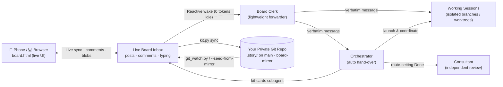

<p align="center">
  
</p>

<h1 align="center">board</h1>

<p align="center">
  <strong>One UI for everything your AI agents build. One Git store. Zero lost context.</strong><br />
  A zero-dependency workflow kit — live mobile-ready board, persistent <code>.story/</code> memory, automatic context-limit handovers, safety hooks, and a one-word launcher — backed entirely by your own private Git repository. Works with <strong>agy</strong> and <strong>Claude Code</strong>, across desktop, phone, and cloud.
</p>

<p align="center">
  
  
  
  
  
</p>

<p align="center">
  <a href="#the-problem">The Problem</a> ·
  <a href="#features">Features</a> ·
  <a href="#architecture">Architecture</a> ·
  <a href="#measured-in-production">Measured Results</a> ·
  <a href="#install">Install</a> ·
  <a href="#runners">Runners</a>
</p>

<p align="center">
  
</p>

---

## The Problem

Chat windows break down as soon as a real project lasts more than a day — **even when you only run one session at a time**:

- **You dig through GitHub and dead chats** just to find what an agent actually built, measured, or decided.
- **Sessions hit context limits, compact, or get reclaimed**, and decisions made in chat quietly vanish.
- **Project sprawl takes over** — every new session starts with *"where are we?"*, *"what's waiting on me?"*, and re-explaining standing rules.
- **Approvals tie you to your desk** — you can't review a report, inspect a screenshot, or unblock an agent from your phone in two seconds.
- **Unchecked agents lose work** — `rm -rf`, `git reset --hard`, force pushes, stranded branches, or leaked `.env` files.

`board` fixes all five with **one Git repository as the single store** and **zero external dependencies** (pure Python 3 stdlib + a single-file HTML board).

---

## Features

### One Visual UI for Everything Agents Create
Every piece of work lives as a structured card in four lanes — **`For you to do`**, **`Waiting on you`**, **`News`**, and **`Done`** — instead of being buried across commits, PRs, and chat transcripts:
- Rich Markdown reports, tables, side-by-side image comparisons, and one-click Markdown export.
- **Phone-first, one-tap control:** tap 👍 to approve, tap a one-tap option to choose, attach screenshots up to 20 MB, and see live typing dots while an agent writes its reply.
- **Live anywhere:** works natively in your browser and on your phone (via `claude.ai` Artifacts in the cloud, or locally via Tailscale — with automatic failover if a cloud plan hits its limit).

### Zero Project Sprawl & Persistent Memory (`.story/`)
Every project gets a committed `.story/` directory (`state/<workstream>.md`, `awaits.md`, `issues/`, `lessons/`, `preferences.md`):
- **Automatic `SessionStart` briefing:** every new session is automatically injected with every workstream's exact `Next:` step, open issues, lessons, and standing preferences before turn 1.
- **At-a-glance cards:** **Where we are**, **Waiting for you**, and **Trains** are rebuilt automatically from `.story/` and the board — never hand-written, never stale.

### Automatic Context-Limit Handovers & Independent Reviews
- **Seamless continuity:** orchestrators and clerks hand over automatically before hitting context ceilings, preserving running work and decisions without losing the thread.
- **Independent consultant:** at route-setting milestones, a fresh reviewer checks the whole train — rerunning numbers instead of rereading prose — and posts a verdict (`continue`, `redirect`, or `stop`).
- **Reactive, low-cost routing:** a lightweight **board clerk** wakes only when you comment (0 tokens while idle), forwards your words verbatim to the exact session that wrote the post, marks it `✓ Seen`, and escalates if unanswered.

### Built-In Safety & Token Discipline
- **`kit_guard.py`** (`PreToolUse`): parses commands with `shlex` to block `rm -rf` outside `/tmp`, `git clean`, `git reset --hard`, force pushes, remote branch deletes, and staging secrets (`.env`, `*.pem`, `*.keystore`), while letting safe commands through cleanly.
- **`kit_stop.py` + `end_session.py`:** stops sessions from exiting with uncommitted or unpushed work, and lands branches cleanly onto trunk (never forced; conflicts abort and name the file).
- **`kit_say_it_once.py`:** keeps full reports in ONE place (the board post) and trims chat/inter-agent chatter to short pointers (`·`).
- **Compact Git lookups (`kit.py`):** mirrors the board to an isolated `board-mirror` branch so agents read a post or open comments in hundreds of characters instead of dumping the whole database.

### One-Word Launch & Modular Adoption
- **One word from any terminal:** installing `board` creates a single-word command named after your project (e.g. `harmonize`) that starts the board, prints your phone link, and opens an unattended session directly into the orchestrator and clerk.
- **Install only what you need:** Step 0 audits your project first and recommends only the layers that pay for themselves (`memory` + hooks, `+ board`, `+ clerk`, `+ orchestrator`). See [docs/KIT-GOALS.md](docs/KIT-GOALS.md) for every quoted problem and measured cost.

---

## Architecture



---

## Measured in Production

Real numbers measured on [anlonlt/harmonize](https://github.com/anlonlt/harmonize) (details in [docs/KIT-GOALS.md](docs/KIT-GOALS.md)):

| Metric | Measured Result |
|---|---|
| **Production volume** | **173 posts**, **1,279 comments**, **47 orchestrator handovers** across 22 workstreams |
| **Median owner wait for a reply** | **0.8 min** (across 398 owner comments; 0 over 15 min in recent handover windows) |
| **Context saved per post read** (`kit.py post`) | **35.9k → 2.9k characters** (12× smaller than full dumps) |
| **Context saved checking open comments** (`kit.py open`) | **~120,000 tokens → 290 characters** |
| **Card rebuild savings** (`kit-cards` via `kit.py`) | **−20% tokens** per run (124,535 → 99,354 tokens) |
| **Startup memory footprint** (`SessionStart`) | **22 workstreams + 31 waiting items** served in **6.6k chars** (instead of 1.3 MB of docs) |
| **Automated verification** | **11 Python test suites, 0 failures** (+ 20/20 mutation tests caught on `kit.py`) |

---

## Quick Start

After installing into your project (e.g. `Harmonize`), open any terminal and type one word:

```bash
harmonize
```

It starts the board server (seeding from `board-mirror` if needed), prints your local and phone links, and launches an unattended orchestrator + clerk session. Pass `harmonize --hybrid` to pair with a cloud Artifact over git (`git_watch.py`).

---

## Install

> [!TIP]
> **One-line install:** open a session in your project repository and paste:
> ```text
> Install the board kit: read https://github.com/anlonlt/board/blob/agy-local/README.md § "Install" and do every step for this repository.
> ```

The hooks' "end your turn with `·`" reminder is about chat turns: your step reports go in the post.
Steps marked **YOU** need a person; the agent prints each one with its direct link when it gets there. Everything else runs automatically.

**For the installing agent, in the project's session.** Do the steps in order; report each step's outcome in one line.

0. **Step 0 first, always:** run the survey (`step0/survey-code.md` or `step0/survey-chat.md`). Show its report to the owner; their yes or changes decide the parts. `install.py` refuses a first install without `--survey <path>` (or `--no-survey "<why>"`).
1. **Get the kit:** `git clone --depth 1 -b agy-local https://github.com/anlonlt/board /tmp/board-kit` (if `/tmp/board-kit` exists, `git -C /tmp/board-kit pull`).
2. **Install it** into the project root:
   ```bash
   python3 -I /tmp/board-kit/install.py . \
     --project "<the project's name>" \
     --talk "<language>" \
     --survey survey/<date>/report.md
   ```
   Optional flags: `--cmd <one-word-command>` (default: project slug, installed to `~/.local/bin/<cmd>`), `--board-port 8765`, `--runtime agy|claude|both`, `--mode local|hybrid`, and partial flags (`--no-board`, `--no-clerk`, `--no-orchestrator`).
   It never deletes and never replaces a file it did not write (`KEPT` lists what it left alone). Existing hook configs are preserved and merged cleanly.
   Check: `python3 -I .agents/hooks/kit/test_hooks.py` ends `0 failed`.
   **Ask the owner once:** *"Every session ends by merging its work onto `<main branch>` and pushing it, never forced (a conflict stops it). Do you give that standing permission?"* Yes: rerun with `--trunk-push yes`. No: sessions push only their own branch. Either way each session ends with `python3 -I .kit/end_session.py`.
3. **Translate (if non-English), then start the board & phone access** (with a board only):
   - If `--talk` is not English: `python3 -I .kit/strings.py template .kit/strings.json`, fill in translations, rerun step 2 with no options.
   - Start the local board server bound to loopback (`127.0.0.1`, recommended with `tailscale serve`) — or pass `--token` / `KIT_BOARD_TOKEN` if binding a non-loopback address (non-loopback binds refuse to start without a token; `./.kit/up` generates and uses a token automatically). For a background daemon: `run_command` with `CommandLine: "python3 -I .kit/board_server.py --host 127.0.0.1 --port 8765"`, `IsDaemon: true`, `WaitMsBeforeAsync: 1000`. Verify `curl -sf http://127.0.0.1:8765/_api/health`.
   - **Phone access via Tailscale (automatic; skipped in cloud-Artifact-only setups):**
     1. Check `which tailscale`: if missing, install it automatically (`curl -fsSL https://tailscale.com/install.sh | sh` on Linux).
     2. Run `sudo tailscale up` in the background (`WaitMsBeforeAsync: 5000`) and hand the owner the one-time login link (`https://login.tailscale.com/a/...`) plus the phone app links ([Android](https://play.google.com/store/apps/details?id=com.tailscale.ipn) · [iOS](https://apps.apple.com/app/tailscale/id1470499037)).
     3. Once `tailscale up` finishes, run `sudo tailscale serve --bg 8765` AND read `tailscale ip -4`. Give the owner **both** links automatically:
        - HTTPS hostname: `https://<machine>.<tailnet>.ts.net/` (enable MagicDNS + HTTPS Certificates once at https://login.tailscale.com/admin/dns)
        - Direct Tailscale IP fallback: `http://<tailscale-ip>:8765/`
     4. **Android Private DNS / NextDNS note (tell the owner upfront):** if their phone uses NextDNS or another Private DNS, Android + Tailscale DNS can conflict ("no network access"). Two fixes: (a) quick: toggle **Use Tailscale DNS = OFF** in the Tailscale app and use `http://<tailscale-ip>:8765/`; or (b) permanent: add NextDNS in Tailscale Admin → Global nameservers and set Android Private DNS to **Automatic**.
     5. Rerun step 2 with `--board-url <the working phone url>`.
   - Commit `.kit .agents .story .gitignore` (and `.claude` if `--runtime both`) and push.
4. **Post your first two posts** in one `board_cli.py batch` (`.kit/BOARD.md` § Post; `created_at` from `date -u +%Y-%m-%dT%H:%M:%SZ`):
   `_orchestrator` (`{title: "Ask the orchestrator", column: "info", part: "orchestrator", priority: 3, created_at, body: "Write here for anything that is not about one post."}`) and
   `KIT-installed` (`{title: "The board kit is installed", column: "info", part: "KIT", priority: 2, session_id: "<your conversationId>", created_at, body: "<what step 2 wrote and kept>"}`).
5. **Start the orchestrator and the clerk** (only those installed):
   - Launch the clerk via `invoke_subagent(TypeName="self", Role="Board Clerk", Model="flash_lite", Workspace="inherit", Prompt=<text of .kit/clerk.md>)`. It registers `comments watch --on`, listens in the background with `board_cli.py comments wait`, and notifies the orchestrator.
   - Run the orchestrator with `.kit/orchestrator.md`: it writes its conversation ID into `_orchestrator`, builds "Where we are" via `kit-cards`, and posts its welcome under `_orchestrator` (including the one-word launch command, phone links, and unattended mode).
6. **YOU, the first comment:** open your phone or local board URL, open `KIT-installed`, write `"test"` and tap **Send comment**. The clerk wakes immediately, passes it to this session via `send_message`, marks it "✓ Seen" and replies "Passed to …". Answer it under the post (`board_cli.py set comments ...`).
7. **The board's copy in git** (`.kit/ORCHESTRATOR.md` § 3):
   `python3 -I .kit/kit.py init`; `T0=$(date -u +%Y-%m-%dT%H:%M:%SZ)`; `python3 -I .kit/board_cli.py list posts --limit 1000 --out-dir /tmp/kd`; `python3 -I .kit/board_cli.py list comments --limit 1000 --out-dir /tmp/kd`; `python3 -I .kit/kit.py sync /tmp/kd --at "$T0" --full --commit`; `python3 -I .kit/kit.py post KIT-installed`; `python3 -I .kit/kit.py push`.
8. **Report**, then end the setup: `python3 -I /tmp/board-kit/install.py . --setup-done`, commit, push. Update `KIT-installed` (`board_cli.py update`) with each step's outcome.
9. **Tell the person what now**, in their language (`language.talk`): their one-word terminal command (e.g. `harmonize`), their phone & local board URLs, what runners are ready, and how to import existing history.

<details>
<summary><strong>Install (Claude Code Web only — <code>--runtime claude</code>)</strong></summary>

Open a Claude Code Web session on **your** repository (`https://claude.ai/code`) and run:

0. **Step 0 first:** run `step0/survey-code.md` or `step0/survey-chat.md` and show the report to the owner.
1. **Get the kit:** `git clone --depth 1 -b agy-local https://github.com/anlonlt/board /tmp/board-kit`
2. **Install with `--runtime claude`:**
   ```bash
   python3 -I /tmp/board-kit/install.py . \
     --runtime claude \
     --project "<the project's name>" \
     --talk "<language>" \
     --survey survey/<date>/report.md
   ```
   Installs `.claude/hooks/kit/*`, `.claude/settings.json`, `.claude/skills/*`, `.claude/agents/kit-cards.md`, and native Claude Code Web templates (`ArtifactData`, `ArtifactComments`, `create_session`, `archive_session`). Check: `python3 -I .claude/hooks/kit/test_hooks.py` ends `0 failed`.
3. **Translate & publish the board Artifact:**
   - Optional translation: `python3 -I .kit/strings.py template .kit/strings.json`, fill in translations, rerun step 2.
   - Publish `.kit/board.html` via `Artifact` `publish` (`icon: "board"`, `capabilities: {"assets": {}, "comments": {}, "db": {}, "user": {}, "downloads": true}`).
   - Rerun step 2 with `--board-url <artifact-url>`, then stop this session's watch (`ArtifactComments` `watch` with `on: false`).
   - Commit `.kit .claude <memory_dir> .gitignore` and push.
4. **Post `_orchestrator` and `KIT-installed`** via `ArtifactData` `batch` (`.kit/BOARD.md` § Post).
5. **Start the orchestrator, then the clerk** via `create_session` using `.kit/orchestrator.md` and `.kit/clerk.md` (with models/effort from `.kit/config.json` `kit.roles`).
6. **Verify first comment**, initialize git mirror (`kit.py init` + `sync --full` + `push`), and finish with `python3 -I /tmp/board-kit/install.py . --setup-done`.

</details>

---

## Runners

Not all work lives in code. Each project's `.story/state/<project>.md` says where it runs (`Runs in:`), and the orchestrator routes each step to the right runner:

| Kind | What it reaches | How a step gets there |
|---|---|---|
| `computer` | Local files, apps, browsers, local servers, VPN/intranet | Runs directly on your computer (or pulled via `.kit/runner.md` / `git_watch.py`) |
| `cloud` | GitHub repo, web, cloud connectors & secrets | Cloud session (`create_session`) |
| `chat` | Microsoft 365, Google, Slack connectors, Projects | A `todo` card with `runner: "<name>"` |
| `owner` | Phone, ears, signature, money, login | A `todo` or `question` card with one-tap answers |
| `scheduled` | Periodic drafts, nightly checks | Recurring `schedule` / cron task |

---

<details>
<summary><strong>Import existing project or chat history</strong></summary>

- **Existing code repository:** run `step0/import-code.md` (rebuilds `.story/state/*.md` and `.story/awaits.md` from repo docs and session history; pass `--no-posts` without a board).
- **Chat history:** paste `step0/export-chat.md` into a new chat to summarize past conversations into one private artifact, then run `python3 -I .kit/kit_import.py <file> --session <orchestrator id>`.

</details>

<details>
<summary><strong>Updating an existing installation</strong></summary>

Pull the latest kit (`git -C /tmp/board-kit pull`) and rerun `python3 -I /tmp/board-kit/install.py .` with no options:
- Keeps `.kit/config.json` and every file you customized (`KEPT` lists them).
- Updates untouched kit files and merges any new hooks cleanly.
- `.kit/manifest.json` (`_kit_commit`) records the exact kit commit installed.

</details>

<details>
<summary><strong>Scripts & Test Suite (Python 3 stdlib, zero dependencies)</strong></summary>

| Script | Purpose |
|---|---|
| `kit/board/board_server.py` | Local HTTP + SSE + SQLite + `/_blob/` board server with `--seed-from-mirror` failover |
| `kit/board/board_cli.py` | CLI for posts, comments, watch/wait/reply, batch writes, and blob assets |
| `kit/git_watch.py` | Lightweight `git ls-remote` listener for git-bridged hybrid mode |
| `kit/up` | One-command launcher (installed as `~/.local/bin/<cmd>`) |
| `scripts/kit.py` | Git mirror (`board-mirror`) + compact lookups (`post`, `open`, `since`, `session`, `diff`, `reads`) |
| `scripts/what_fills.py` | Measures what fills a session's context window by source |
| `scripts/mirror_holes.py` | Audits a board dump for fields written later without stamps |
| `scripts/token_probe.py` | Measures exact token cost of a read from transcript usage |

Run all 11 test suites:
```bash
for t in test_install.py test_install_bd11.py kit/board/test_board_local.py \
         kit/test_git_watch.py kit/import/test_kit_import.py kit/board/test_kit_cards.py \
         kit/test_end_session.py kit/hooks/test_hooks.py kit/clerk/test_clerk_pending.py \
         scripts/test_kit.py scripts/test_survey_scripts.py; do
  python3 -I "$t"
done
```

</details>

<details>
<summary><strong>Feedback & Bug Reports (Private Board, Public Reports)</strong></summary>

Your project and board stay private; only an anonymized report goes to `anlonlt/board`:
- Save as `survey/<YYYY-MM-DD>/<short-slug>.md` (no personal data, no names of people or organizations).
- Collaborators can branch `feedback/<date>-<slug>`, push, and open a PR into `main`; otherwise open [anlonlt/board/issues/new](https://github.com/anlonlt/board/issues/new).

</details>
