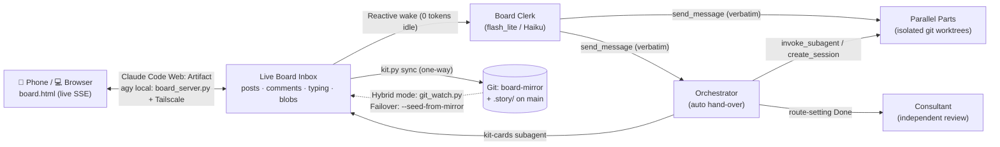

<p align="center">
  
</p>

<h1 align="center">board</h1>

<p align="center">
  <strong>One UI for everything your AI agents build. One Git store. Zero lost context.</strong><br />
  A zero-dependency workflow kit for <strong>agy</strong> and <strong>Claude Code</strong>: a live phone-ready board, persistent <code>.story/</code> memory, automatic context-limit handovers, safety hooks, and a one-word launcher — backed entirely by your own private Git repository.
</p>

<p align="center">
  
  
  
  
  
</p>

<p align="center">
  <a href="#-why-board-even-for-one-session">Why board?</a> ·
  <a href="#-how-it-compares">Comparison</a> ·
  <a href="#-architecture">Architecture</a> ·
  <a href="#-measured-in-production">Measured Results</a> ·
  <a href="#install">Install</a> ·
  <a href="#-runners-code-and-beyond">Runners</a>
</p>

<p align="center">
  
</p>

---

## ⚡ Why `board`? (Even for ONE Session at a Time)

> [!IMPORTANT]
> **`board` is not only for parallel multi-agent swarms.** Even if you run a single AI session at a time, chat windows alone break down as soon as a project lasts more than a day.

| The pain you feel today | How `board` fixes it |
|---|---|
| **Digging through GitHub & dead chats** to find what an agent actually built, measured, or decided | **One visual UI for every artifact** — reports, tables, side-by-side screenshots, Markdown exports, and review verdicts live as clean cards in four lanes (`For you to do`, `Waiting on you`, `News`, `Done`). |
| **Context limits & lost continuity** — a session hits its cap, compacts, or gets reclaimed, and decisions made in chat vanish | **Automatic handovers + `.story/` memory** — orchestrators and clerks hand over before context fills; `SessionStart` hooks inject every workstream's exact `Next:` step, open issues, and lessons into every new session automatically. |
| **Project sprawl** — opening a new chat and typing *"where are we?"* or *"what is waiting on me?"* every morning | **At-a-glance cards** — **Where we are**, **Waiting for you**, and **Trains** are rebuilt automatically from `.story/` and the board so you see every workstream and blocker in one second. |
| **Stuck at your desk** — waiting on long runs or answering approvals in a desktop terminal | **Phone-first, one-tap control** — tap 👍 to approve, tap a one-tap option to choose, attach a phone screenshot, and see live typing dots from anywhere (median reply wait: **0.8 min**). |
| **Agents breaking or deleting work** — `rm -rf`, `git reset --hard`, force pushes, unpushed branches, leaked `.env`/keystores | **Deterministic safety hooks** — `kit_guard.py` hard-blocks destructive commands and secret leaks; `kit_stop.py` + `end_session.py` keep your trunk clean and pushed. |
| **Triple-token chatter** — agents repeating the same report in chat, to you, and in docs | **Say-it-once enforcement** — `kit_say_it_once.py` keeps the full result in ONE board post and trims chat/inter-agent messages to short pointers (`·`). |

Every part is modular (see [docs/KIT-GOALS.md](docs/KIT-GOALS.md) for every quoted problem and measured cost): start with memory + hooks, add the board UI for phone/visual access, and turn on the clerk + orchestrator + consultant whenever you run parallel work.

---

## 🥊 How It Compares

| Capability | **board** | Vibe Kanban *(sunsetting)* | Kanban Code | Beads (`bd`) | Storybloq |
|---|:---:|:---:|:---:|:---:|:---:|
| **Zero external dependencies** *(Python 3 stdlib + 1 HTML file)* | ✅ | ❌ *(Rust + Node + pnpm)* | ❌ *(SwiftUI / Tauri + tmux)* | ❌ *(Go + Dolt SQL)* | ❌ *(Node 20+ + Mac app)* |
| **Visual UI for reports, tables & screenshots** | ✅ | ✅ *(diffs/kanban)* | ✅ *(desktop)* | ❌ *(CLI only)* | ⚠️ *(Mac sidebar app)* |
| **Phone-first one-tap answers, Likes & attachments** | ✅ | ❌ | ⚠️ *(push only)* | ❌ | ❌ |
| **Automatic context-limit handovers & continuity** | ✅ | ❌ | ❌ | ⚠️ *(compaction)* | ⚠️ *(manual handover)* |
| **Git as the single durable store** | ✅ *(`.story/` + `board-mirror`)* | ❌ *(local SQLite)* | ❌ *(local app)* | ✅ *(Dolt)* | ✅ *(`.story/`)* |
| **Works on `agy` (local) + Claude Code Web + Hybrid Failover** | ✅ | ⚠️ *(local CLIs)* | ❌ *(Claude CLI only)* | ⚠️ *(local CLIs)* | ⚠️ *(Claude + Codex)* |
| **Works on Linux, macOS, Windows & ChromeOS** | ✅ | ✅ | ❌ *(macOS 26 / Win)* | ✅ | ⚠️ *(UI is Mac-only)* |
| **Non-code work** *(M365, browser, chat, human todos)* | ✅ *(Runners)* | ❌ | ❌ | ❌ | ❌ |
| **One-word terminal launcher** *(e.g. `harmonize`)* | ✅ | ❌ | ⚠️ *(`kanban`)* | ❌ | ❌ |

---

## 🏗 Architecture



### Three Ways to Run (Same Repo, Zero Lock-In)

| Mode | Board UI | How Agents Wake | Best For |
|---|---|---|---|
| **`agy` Local** *(default on `agy-local`)* | Local `.kit/board_server.py` + free **Tailscale** for phone | `board_cli.py comments wait` + `send_message` | Full local speed, direct access to your computer's files/browsers/servers, one-word launch (`harmonize`), zero cloud limits. |
| **Hybrid + Failover** *(`--runtime both --mode hybrid`)* | **claude.ai Artifact** on phone + `board_server.py --seed-from-mirror` on failover | Claude Code Web wakes natively; `agy` listens via `.kit/git_watch.py` (no Tailscale needed until failover) | Best of both worlds: 24/7 cloud Artifact on your phone + local `agy` computer worker, with instant local UI failover if Claude hits a usage cap. |
| **Claude Code Web** *(`main` branch)* | **claude.ai Artifact** | `ArtifactComments` webhooks | Pure cloud workflow with no local machine required. |

---

## 📊 Measured in Production

Real numbers measured on [anlonlt/harmonize](https://github.com/anlonlt/harmonize) (see [docs/KIT-GOALS.md](docs/KIT-GOALS.md)):

| Metric | Measured Result |
|---|---|
| **Production volume** | **173 posts**, **1,279 comments**, **47 orchestrator handovers** across 22 workstreams |
| **Median owner wait for a reply** | **0.8 min** (across 398 owner comments; 0 over 15 min in recent handover windows) |
| **Context saved per post read** (`kit.py post`) | **35.9k → 2.9k characters** (12× smaller than raw dumps) |
| **Context saved checking open comments** (`kit.py open`) | **~120,000 tokens → 290 characters** |
| **Card rebuild savings** (`kit-cards` via `kit.py`) | **−20% tokens** per run (124,535 → 99,354 tokens) |
| **Memory served at every `SessionStart`** | **22 workstreams + 31 waiting points** injected in **6.6k chars** (instead of re-reading 1.3 MB of docs) |
| **Automated verification** | **11 Python test suites, 0 failures** (+ 20/20 mutation tests caught on `kit.py`) |

---

## 🚀 Quick Start (One Word After Install)

Once installed into your project (e.g. `Harmonize`), `install.py` creates a one-word command in `~/.local/bin/harmonize`. From **any** terminal window, you just type:

```bash
harmonize
```

That single word automatically:
1. Starts the local board server (`0.0.0.0:8765`, auto-seeding from `origin/board-mirror` on first run)
2. Prints your local URL and your **Tailscale phone URL(s)**
3. Opens `agy --mode auto` straight into the **orchestrator + board clerk** (zero Ctrl+K approval prompts while you reply from your phone; `kit_guard.py` still blocks destructive commands)

*(Use `harmonize --hybrid` to launch in hybrid git-watch mode with Claude Code Web's Artifact.)*

---

## Install

> [!TIP]
> **One-line install for `agy` on your computer:** open an `agy` session in your repository and paste:
> ```text
> Install the board kit: read https://github.com/anlonlt/board/blob/agy-local/README.md § "Install" and do every step for this repository.
> ```

The hooks' "end your turn with `·`" reminder is about chat turns: your step reports go in the post.
Steps marked **YOU** need a person; `agy` says each one, with its exact link, when it gets there. Everything else is `agy`'s.

**How `agy` on a computer matches Claude Code Web (zero external dependencies):**
- **Hooks & Skills:** installed into `.agents/hooks.json` (`kit-board` named hook), `.agents/hooks/kit/*.py` (camelCase JSON stdin/stdout), and `.agents/skills/{story,board}/SKILL.md`. Pass `--runtime both` to install `.claude/` side-by-side for Claude Code Web compatibility.
- **Board UI & Store:** `.kit/board_server.py` serves `.kit/board.html` locally with an injected `window.claude` shim (`/_shim.js`) backed by SQLite (`.kit/board_data/board.db`, gitignored) + Server-Sent Events (`/_api/events`) + local blobs (`/_blob/<id>`).
- **Board CLI & Git Bridge:** `.kit/board_cli.py` replaces `ArtifactData`/`ArtifactComments`/`Artifact`; `.kit/git_watch.py` watches `origin/board-mirror` for hybrid mode; `--seed-from-mirror` gives instant local failover.
- **Multi-Agent Orchestration & Timers:** `invoke_subagent` (`Workspace: "share"` for parallel git worktrees), `define_subagent` (`kit-cards`), `send_message`, `manage_subagents`, `schedule`, and `run_command(IsDaemon=true)`.

**For `agy`, in the project's session.** Do the steps in order; report each step's outcome in one line.

0. **Step 0 first, always:** run the survey (`step0/survey-code.md` or `step0/survey-chat.md`). Show its report to the owner; their yes or changes decide the parts. `install.py` refuses a first install without `--survey <path>` (or `--no-survey "<why>"`).
1. **Get the kit:** `git clone --depth 1 -b agy-local https://github.com/anlonlt/board /tmp/board-kit` (if `/tmp/board-kit` exists, `git -C /tmp/board-kit pull`).
2. **Install it** into the project root:
   ```bash
   python3 -I /tmp/board-kit/install.py . \
     --project "<the project's name>" \
     --talk "<language>" \
     --survey survey/<date>/report.md
   ```
   Optional flags: `--cmd <one-word-command>` (default: project slug), `--board-port 8765`, `--runtime agy|claude|both`, `--mode local|hybrid`, and the parts step 0 recommended (`--no-board`, `--no-clerk`, `--no-orchestrator`).
   It never deletes and never replaces a file it did not write (`KEPT` lists what it left alone). Your `.agents/hooks.json` keeps every other named hook.
   Check: `python3 -I .agents/hooks/kit/test_hooks.py` ends `0 failed`.
   **Ask the owner once:** *"Every session ends by merging its work onto `<main branch>` and pushing it, never forced (a conflict stops it). Do you give that standing permission?"* Yes: rerun with `--trunk-push yes`. No: sessions push only their own branch. Either way each session ends with `python3 -I .kit/end_session.py`.
3. **Translate (if non-English), then start the local board server & phone access** (with a board only):
   - If `--talk` is not English: `python3 -I .kit/strings.py template .kit/strings.json`, fill in translations, rerun step 2 with no options.
   - Start the local board server bound to all interfaces as a background daemon (`run_command` with `CommandLine: "python3 -I .kit/board_server.py --host 0.0.0.0 --port 8765"`, `IsDaemon: true`, `WaitMsBeforeAsync: 1000`). Verify `curl -sf http://127.0.0.1:8765/_api/health`.
   - **Phone access via Tailscale (automatic in `local` mode or failover; skipped in `hybrid`-only mode if not wanted):**
     1. Check `which tailscale`: if missing, install it automatically (`curl -fsSL https://tailscale.com/install.sh | sh` on Linux).
     2. Run `sudo tailscale up` in the background (`WaitMsBeforeAsync: 5000`) and hand the owner the one-time login link (`https://login.tailscale.com/a/...`) plus the phone app links ([Android](https://play.google.com/store/apps/details?id=com.tailscale.ipn) · [iOS](https://apps.apple.com/app/tailscale/id1470499037)).
     3. Once `tailscale up` finishes, run `sudo tailscale serve --bg 8765` AND read `tailscale ip -4`. Give the owner **both** links automatically:
        - HTTPS hostname: `https://<machine>.<tailnet>.ts.net/` (requires MagicDNS + HTTPS Certificates once at https://login.tailscale.com/admin/dns)
        - Direct Tailscale IP fallback: `http://<tailscale-ip>:8765/`
     4. **Android Private DNS / NextDNS note (tell the owner upfront):** if their phone uses NextDNS or another Private DNS, Android + Tailscale DNS can conflict ("no network access"). Two fixes: (a) quick: toggle **Use Tailscale DNS = OFF** in the Tailscale app and use `http://<tailscale-ip>:8765/`; or (b) permanent: add NextDNS in Tailscale Admin → Global nameservers and set Android Private DNS to **Automatic**.
     5. Rerun step 2 with `--board-url <the working phone url>`.
   - **One-word daily launch command:** `install.py` installs a one-word command in `~/.local/bin/<project-slug>` (customizable with `--cmd <word>`, e.g. `harmonize`). From any terminal, the owner just types **`harmonize`** — it starts `board_server.py`, prints their phone URLs, and opens `agy --mode auto` straight into the orchestrator + clerk (`harmonize --hybrid` for hybrid mode).
   - Commit `.kit .agents .story .gitignore` and push.
4. **Post your first two posts** in one `board_cli.py batch` (`.kit/BOARD.md` § Post; `created_at` from `date -u +%Y-%m-%dT%H:%M:%SZ`):
   `_orchestrator` (`{title: "Ask the orchestrator", column: "info", part: "orchestrator", priority: 3, created_at, body: "Write here for anything that is not about one post."}`) and
   `KIT-installed` (`{title: "The board kit is installed", column: "info", part: "KIT", priority: 2, session_id: "<your conversationId>", created_at, body: "<what step 2 wrote and kept>"}`).
5. **Start the orchestrator and the clerk** (only those installed):
   - Launch the clerk via `invoke_subagent(TypeName="self", Role="Board Clerk", Model="flash_lite", Workspace="inherit", Prompt=<text of .kit/clerk.md>)`. It registers `comments watch --on`, listens in the background with `board_cli.py comments wait`, and notifies the orchestrator.
   - Run the orchestrator with `.kit/orchestrator.md`: it writes its conversation ID into `_orchestrator`, builds "Where we are" via `kit-cards`, and posts its `agy`-specific welcome under `_orchestrator`.
6. **YOU, the first comment:** open your phone or local board URL, open `KIT-installed`, write `"test"` and tap **Send comment**. The clerk wakes immediately, passes it to this session via `send_message`, marks it "✓ Seen" and replies "Passed to …". Answer it under the post (`board_cli.py set comments ...`).
7. **The board's copy in git** (`.kit/ORCHESTRATOR.md` § 3):
   `python3 -I .kit/kit.py init`; `T0=$(date -u +%Y-%m-%dT%H:%M:%SZ)`; `python3 -I .kit/board_cli.py list posts --limit 1000 --out-dir /tmp/kd`; `python3 -I .kit/board_cli.py list comments --limit 1000 --out-dir /tmp/kd`; `python3 -I .kit/kit.py sync /tmp/kd --at "$T0" --full --commit`; `python3 -I .kit/kit.py post KIT-installed`; `python3 -I .kit/kit.py push`.
8. **Report**, then end the setup: `python3 -I /tmp/board-kit/install.py . --setup-done`, commit, push. Update `KIT-installed` (`board_cli.py update`) with each step's outcome.
9. **Tell the person what now**, in their language (`language.talk`): their one-word terminal command (e.g. `harmonize`), their phone & local board URLs, what runners are ready (`computer` is ready immediately), and how to import existing history.

---

## 🧩 Runners: Code and Beyond

The kit does not assume all work is code. Each project's `.story/state/<project>.md` says where it runs (`Runs in:`), and the orchestrator routes each step to the right runner:

| Kind | What it reaches | How a step gets there | One-time setup |
|---|---|---|---|
| `computer` | Your computer: local files, apps, browsers, local servers, VPN/intranet | Native in `agy` on this computer (or `runner: "<name>"` card pulled by `.kit/runner.md` / `git_watch.py`) | Ready out of the box in `agy` |
| `cloud` | GitHub repo, web, cloud connectors & secrets | Claude Code Web session (`create_session`) | Claude Code Web connected to repo |
| `chat` | A claude.ai chat: M365, Google, Slack connectors, Projects | A `todo` card with `runner: "<name>"` pasted into chat | Connectors enabled in claude.ai |
| `owner` | Phone, ears, signature, money, login | A `todo` or `question` card with one-tap answers | None |
| `scheduled` | Periodic drafts, nightly checks | `schedule(CronExpression=..., IsDaemon=true)` | None |

---

<details>
<summary><strong>📥 Import existing project or chat history into the kit</strong></summary>

The kit's memory and board start empty.
- **Existing code repository:** run `step0/import-code.md` (rebuilds `.story/state/*.md` and `.story/awaits.md` from repo docs and session history; pass `--no-posts` without a board).
- **Chat-only history (claude.ai):**
  1. Paste `step0/export-chat.md` into a new claude.ai chat — Claude summarizes your past chats into one private "kit state" artifact and gives you one line to paste back.
  2. Run `python3 -I .kit/kit_import.py <file> --session <orchestrator id>` to populate `.story/` and print the initial board posts batch.

</details>

<details>
<summary><strong>🔄 Updating an existing installation</strong></summary>

Pull the latest kit from `anlonlt/board` (`git -C /tmp/board-kit pull`) and rerun `python3 -I /tmp/board-kit/install.py .` with no options:
- Keeps `.kit/config.json` and every file you customized (`KEPT` lists them).
- Updates untouched kit files and merges any new hooks into `.agents/hooks.json` (and `.claude/settings.json` if `--runtime both`).
- `.kit/manifest.json` (`_kit_commit`) records the exact kit commit installed.

</details>

<details>
<summary><strong>🧪 Scripts, Step 0 Survey & Test Suite</strong></summary>

All scripts live in `scripts/` and `kit/` — **pure Python 3, zero dependencies**:

| Script | Purpose |
|---|---|
| `kit/board/board_server.py` | Local HTTP + SSE + SQLite + `/_blob/` board server with `window.claude` shim & `--seed-from-mirror` |
| `kit/board/board_cli.py` | CLI for posts, comments, watch/wait/reply, batch writes, and blob assets |
| `kit/git_watch.py` | Lightweight `git ls-remote` listener for hybrid Claude Code Web ↔ `agy` mode |
| `kit/up` | One-command launcher (installed as `~/.local/bin/<cmd>`) |
| `scripts/kit.py` | Git mirror (`board-mirror`) + compact lookups (`post`, `open`, `since`, `session`, `diff`, `reads`) |
| `scripts/what_fills.py` | Measures what fills a session's context window by source |
| `scripts/mirror_holes.py` | Audits a board dump for fields written later without stamps |
| `scripts/token_probe.py` | Measures exact token cost of a read from transcript usage |

Run all 11 test suites:
```bash
for t in test_install.py test_install_bd11.py kit/board/test_board_local.py \
         kit/test_git_watch.py kit/import/test_kit_import.py kit/board/test_kit_cards.py \
         kit/test_end_session.py kit/hooks/test_hooks.py kit/clerk/test_clerk_pending.py \
         scripts/test_kit.py scripts/test_survey_scripts.py; do
  python3 -I "$t"
done
```

</details>

<details>
<summary><strong>📣 Feedback & Bug Reports (Private Board, Public Reports)</strong></summary>

Your project and board stay private; only an anonymized report goes to `anlonlt/board`:
- Save as `survey/<YYYY-MM-DD>/<short-slug>.md` (no personal data, no names of people or organizations).
- If you are a collaborator on `anlonlt/board`: branch `feedback/<date>-<slug>`, commit only that file, push, and open a PR into `main`.
- Otherwise: open [anlonlt/board/issues/new](https://github.com/anlonlt/board/issues/new) and paste the report.

</details>
