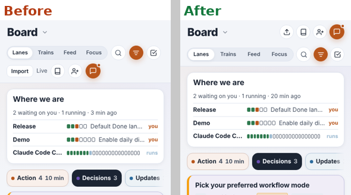
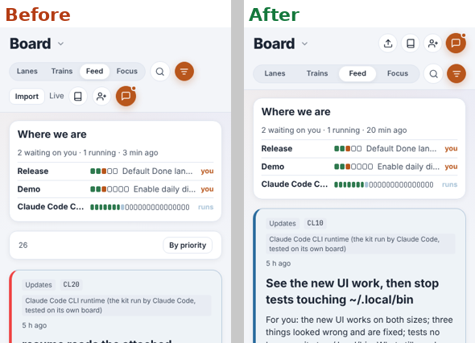
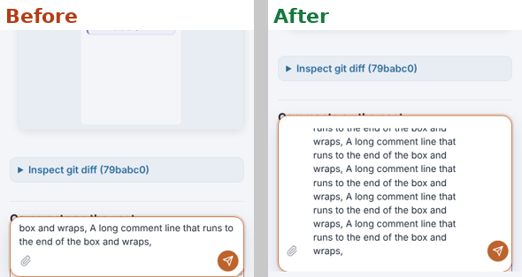
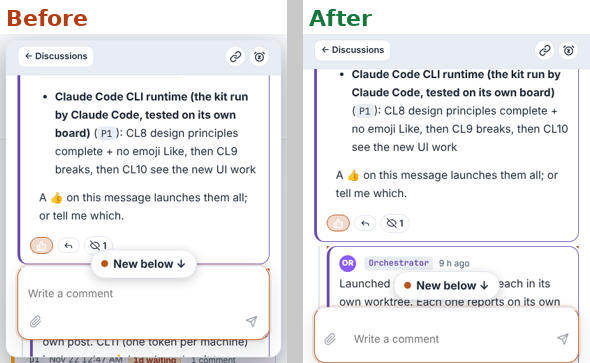
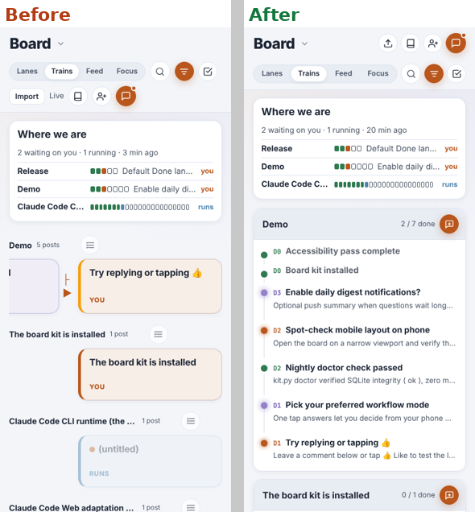
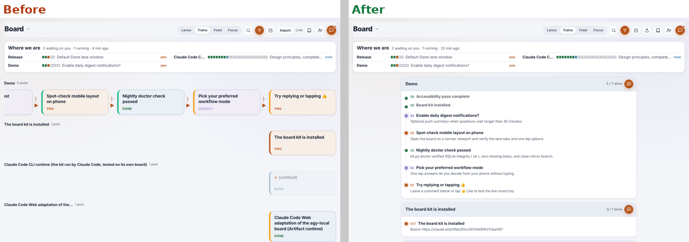
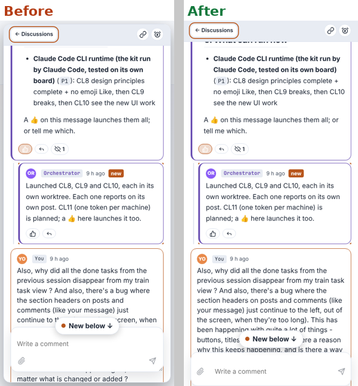
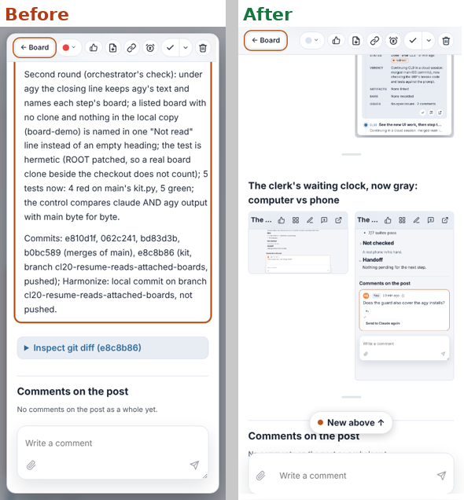
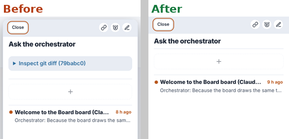
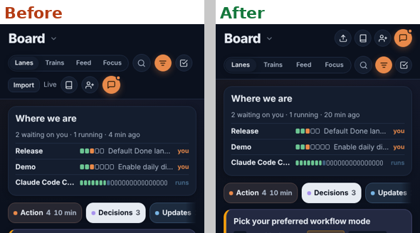

# CL27: the board's UI and UX audit, and the fixes

The owner's ask (comment `qswsgntf01y58bpp6n74` on `_orchestrator`, 2026-11-23 07:08): find and fix every UI and UX
problem, on a computer but above all on the phone, starting with a full audit, visual and in code.

How the audit was made: every view (Lanes, Feed, Focus, Trains, a train's task list, a post, its comments and the
comment box, the orchestrator and a discussion, a feed post's comments, the attached-board switcher) rendered with
Playwright on this repo's own board, at 411 px with touch (and 360 px in the test) and at 1300 px, light and dark, then
again with the keyboard open (the visible part of the screen shrunk to 470 px, also panned 300 px down). Then each view's
code read for the cause. 54 pictures before, 54 after; the pairs below are cut from them (left before, right after).

Each fix has a check in `kit/board/test_page_ux.js`: 33 checks, 0 fail now. On main's page 23 of the first 31 fail; the last 2 (rows 14 and 15) fail on the first CL27 page.

## His named problems

| # | What he saw | Cause in the code | Fix | Check |
|---|---|---|---|---|
| 1 | The comment box not adapted to the keyboard, a huge margin on top | Sheets are `position: fixed; inset: 0` against the layout viewport; on Android the keyboard only shrinks the visual viewport, so the browser pans the page and the sheet's top (its bar) and its sticky box no longer match what is visible; the orchestrator's box also sat 24 px above its window's bottom (the scroller's padding) | While a field has focus and the keyboard takes more than 120 px, `html.kit-kbd` pins the open sheet to the visual viewport (top and height from `visualViewport`), the box scrolls fully into view, its text area is capped at 35% of what is visible; the local server's viewport meta adds `interactive-widget=resizes-content` | "keyboard open (visible 0..470 / 300..770)": box inside the visible part and on the keyboard, the bar at its top |
| 2 | Send and attachment buttons cover the text | Both buttons were `position: absolute` over the bottom of the text area; long text scrolled under them | The box is a row: paperclip, text, send; the text area grows with the text (`field-sizing: content`, a script where the browser lacks it) up to a cap; the same for the Focus view's box | "the send and attach buttons sit beside the text, never over it" (their boxes never intersect the text area) |
| 3 | The train view looks half-baked; the task list is more informative, less scroll-heavy | The flow map draws one card per open step on a sideways row aligned to the right: a train with one step is one card at the far right, the rest of the row empty; cards cut at the left edge; done steps absent | The Trains view is each train's task list (the window that opened from the list button), one card per train with its done count; open steps show their verdict line, done steps one line each; a tap opens a step's fields | "the Trains view is each train's task list, done steps included" |
| 4 | Blue highlights whenever you tap something | No `-webkit-tap-highlight-color` anywhere: Chrome on Android draws its default, `rgba(51, 181, 229, .4)` (measured on main) | `html { -webkit-tap-highlight-color: transparent }`; buttons already shrink a little on press | "no tap highlight on a button or a card" |
| 5 | Tapping an underlined wrong word hides the keyboard until a correction is picked | Not the page: on a tap and on a live reply the box keeps focus (measured, on main too). The red underline and its menu are Chrome's own spelling menu, which hides the keyboard while it shows | On a touch screen the comment boxes leave spelling to the keyboard (`spellcheck=false`, autocorrect on): Gboard's suggestion strip still corrects, and no tap opens Chrome's menu. The computer keeps the red underline | "a tap in the text and a live reply keep the box focused"; "the box does not ask for the browser's spelling menu" |
| 6 | A bar at the top of the feed with a post count and a sort button, useless next to the header's sort | `renderOpenFeed()` drew its own bar and its own sort toggle | Removed; the header's sort button orders the feed | "the feed has no bar with a post count and a second sort button" |
| 7 | Header buttons that do not fit on the phone | The header wrapped wherever its 11 controls ran out of room: a third row at 411 px, `Import` and `Live` as words | On a phone, two fixed rows: the board's name and its actions (Import, Repo docs, Share, Ask), then the views and the list tools; Import is an icon; "Live" shows only when something is wrong; the search opens over the views | "the header is at most two clean rows, every control on screen, none over another" at 360 and 411 px, in Lanes, Feed and Trains; one row on the computer |

## Other problems the audit found

| # | Problem | Cause | Fix | Check |
|---|---|---|---|---|
| 8 | The orchestrator on a phone is a rounded card 8 px from every edge (he asked for full sheets on the phone, CL10) | `.sheet.orch-popup { inset: 8px }` under 640 px | Full sheet, square, edge to edge | "the orchestrator is a full sheet, edge to edge" |
| 9 | A feed post's comments on a phone: the same, 12 px from the edges | `.sheet.feed-comments-overlay { inset: 12px }` | Full sheet | "a feed post's comments open as a full sheet" |
| 10 | Messages show below the orchestrator's comment box | Its scroller's 24 px bottom padding: the sticky box stopped 24 px above the window's edge | No padding under the box | "no message shows below the orchestrator's comment box" |
| 11 | The "New below" pill sits on the comment box | Fixed at `bottom: 112px` in a post, at its default in the orchestrator, whatever the box's height | Placed 10 px above the box whenever the box is on screen | "the New below pill is not over the comment box" |
| 12 | The orchestrator shows "Inspect git diff (79babc0)", the diff of the post opened before | `enhancePostSheet()` returned early for the orchestrator before removing the last post's diff | The diff is removed when the orchestrator or a `_` post opens | "the orchestrator does not show the git diff of the post opened before it" |
| 14 | A grown comment box: about 21 px blank above its text and extra room beside the paperclip (the owner and the orchestrator's review saw it) | The box's old `gap: 8px` (it was a flex column) became a grid gap: 8 px per empty row (reply, files) above the text, and between the columns | `gap: 0` on the box's grid | "no blank above the text in a grown box" |
| 15 | With the keyboard open and the page panned, the "New below" pill sat on the box's text | Its fixed `bottom` was counted from the keyboard's top instead of the layout viewport's bottom, and it was placed only when it first showed | Counted from the layout viewport; placed again when the keyboard opens, the page pans or the box grows | "keyboard open and panned: the New below pill shows and is not over the box" |
| 13 | The post's box floated 8 px above the bottom with the post scrolling visibly under it | `bottom: 8px` with nothing behind the gap | 10 px from the bottom with the page's color behind the gap | "no text of the post shows below the comment box" |

## Looked at, not a problem

- The orange ring on "Board" / "Close" in the first pictures: it came from the audit's scripted clicks; after a real tap
  the button is not `:focus-visible` and has no ring (measured).
- Dark mode: the same layout in every view; nothing unreadable in the dark pictures looked at (phone, every view; computer, Lanes and the orchestrator).
- Lanes on the computer, the post sheet, Focus: no overlap, nothing off screen (also `test_page_layout.js`).
- The attached-board switcher: its menu opens under the name and stays on screen at 411 px.

## What is left

- A look on his real phone: the keyboard was emulated (the visible part shrunk, also panned), and Chrome's spelling
  menu cannot be opened in a headless browser.
- His taste: the Trains view as task lists (A, now) or the old flow map (B); the question is on post CL27.
- Turning the browser's spelling off on the phone trades the red underline for the keyboard's suggestion strip; if he
  prefers the underline, it is one line (`spellFor` in `kit/board/board.template.html`).
